<a href="https://github.com/DarlanSchwartz">
  <picture>
    <source media="(prefers-color-scheme: dark)" srcset="assets/banner-dark.svg">
    <source media="(prefers-color-scheme: light)" srcset="assets/banner-light.svg">
    
  </picture>
</a>

### Hello World, I'm Darlan 👋

A problem solver — also known as a software engineer. I build native Windows tools in **C#/.NET**, web apps, APIs and bots in **TypeScript**, and games in **Unity**. Ask me about anything!

- 🎮 **10+ years** in multiplatform game development
- 🌐 **5+ years** in web and mobile development
- 💼 **Mid-Level → Tech Lead** in less than 2 years
- 🏆 **3× hackathon winner**, plus 2nd, 3rd and 5th places — 7 hackathons as a full-stack developer
- 🔗 **2 Web3 hackathons** — experienced with blockchain technologies
- ✈️ **Web Summit 2025, Lisbon** — won an all-expenses-paid trip and tickets
- 🧠 Quickly reads and understands code in virtually any language
- 🌱 Currently learning **AWS** (Lambda, EC2, S3, CloudFormation)
- 🌍 **Trilingual:** English · Spanish · Portuguese (native)

## 🚀 Featured projects

| Project | What it is | Built with |
| --- | --- | --- |
| [**HowsMyUsage**](https://github.com/DarlanSchwartz/HowsMyUsage) | Native Windows widget showing remaining Codex, Gemini and Claude usage limits — no Electron or Tauri | C# · .NET 10 |
| [**Reminder**](https://github.com/DarlanSchwartz/Reminder) | Windows to-do widget with full-screen alarms, repeat rules, Task Scheduler integration and a CLI for scripts and AI agents | C# · WPF · .NET 10 |
| [**CredChain**](https://github.com/DarlanSchwartz/CredChain) | Ethereum dApp with Solidity smart contracts, an Express backend and a React frontend | Solidity · Hardhat · Ethers.js · React |
| [**Atena IA**](https://github.com/DarlanSchwartz/Hackathon-CAPES) | Hackathon project: AI chat web app with its own [API](https://github.com/DarlanSchwartz/API-Hackathon-CAPES) and [Telegram bot](https://github.com/DarlanSchwartz/Bot-Atena-IA) | TypeScript · React · Node.js |
| [**GameAlert**](https://github.com/DarlanSchwartz/GameAlert) | Discord bot that alerts about free games | TypeScript · discord.js |
| [**Puzzle-Systems**](https://github.com/DarlanSchwartz/Puzzle-Systems) | Unity playground of game puzzles, save games, inventory and drag-and-drop systems | C# · Unity |

More on my <a href="https://github.com/DarlanSchwartz?tab=repositories">repositories page</a>.

## 🧰 Tech stack

<table>
  <tr>
    <td><b>Languages</b></td>
    <td>
      <picture>
        <source media="(prefers-color-scheme: light)" srcset="https://skillicons.dev/icons?i=cs,ts,js,solidity,html,css,bash&theme=light">
        
      </picture>
    </td>
  </tr>
  <tr>
    <td><b>Games & desktop</b></td>
    <td>
      <picture>
        <source media="(prefers-color-scheme: light)" srcset="https://skillicons.dev/icons?i=unity,dotnet,visualstudio,windows,electron,blender,ps,androidstudio&theme=light">
        
      </picture>
    </td>
  </tr>
  <tr>
    <td><b>Web & backend</b></td>
    <td>
      <picture>
        <source media="(prefers-color-scheme: light)" srcset="https://skillicons.dev/icons?i=react,nextjs,vite,styledcomponents,nodejs,express,prisma,jest,discordjs&theme=light">
        
      </picture>
    </td>
  </tr>
  <tr>
    <td><b>Data & cloud</b></td>
    <td>
      <picture>
        <source media="(prefers-color-scheme: light)" srcset="https://skillicons.dev/icons?i=postgres,mongodb,redis,docker,nginx,aws,gcp,vercel&theme=light">
        
      </picture>
    </td>
  </tr>
  <tr>
    <td><b>Tools</b></td>
    <td>
      <picture>
        <source media="(prefers-color-scheme: light)" srcset="https://skillicons.dev/icons?i=git,github,gitlab,vscode,figma,notion,npm&theme=light">
        
      </picture>
    </td>
  </tr>
</table>

Also: React Native · Mongoose · Babel · Photon · Mixamo · Fuse · MakeHuman · SpeedTree · CrazyBump · Replica · Audacity · Shotcut · Jira · Asana

## ⚡ GitHub stats

Most of my recent work lives on GitLab and in private repositories, so these cards show only part of it.

  <picture>
    <source media="(prefers-color-scheme: dark)" srcset="https://github-readme-stats.vercel.app/api?username=DarlanSchwartz&show_icons=true&include_all_commits=true&count_private=true&hide_border=true&theme=github_dark&title_color=8B5CF6&icon_color=06B6D4">
    
  </picture>
  <picture>
    <source media="(prefers-color-scheme: dark)" srcset="https://github-readme-stats.vercel.app/api/top-langs/?username=DarlanSchwartz&layout=compact&langs_count=8&hide_border=true&theme=github_dark&title_color=8B5CF6">
    
  </picture>

  <picture>
    <source media="(prefers-color-scheme: dark)" srcset="https://streak-stats.demolab.com/?user=DarlanSchwartz&hide_border=true&theme=github-dark-blue&ring=8B5CF6&fire=06B6D4&currStreakLabel=8B5CF6">
    
  </picture>

## 📫 Contact

  
  

