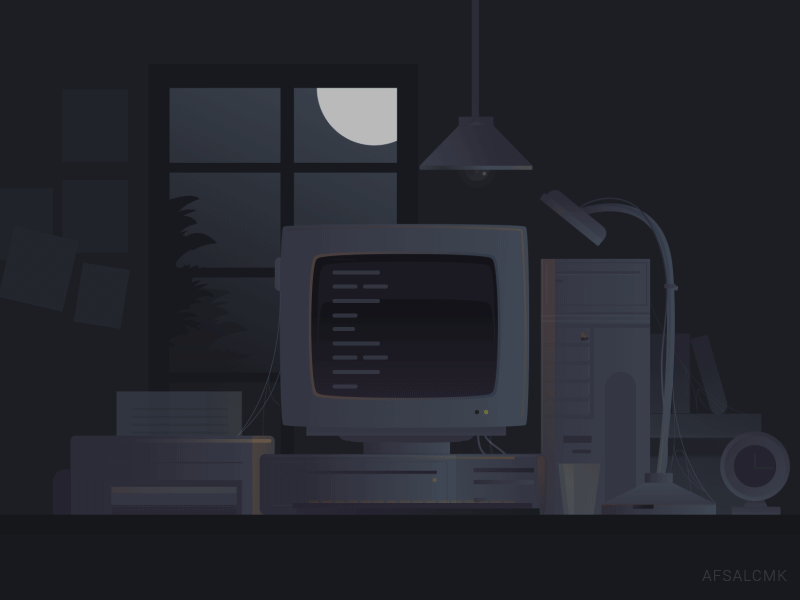
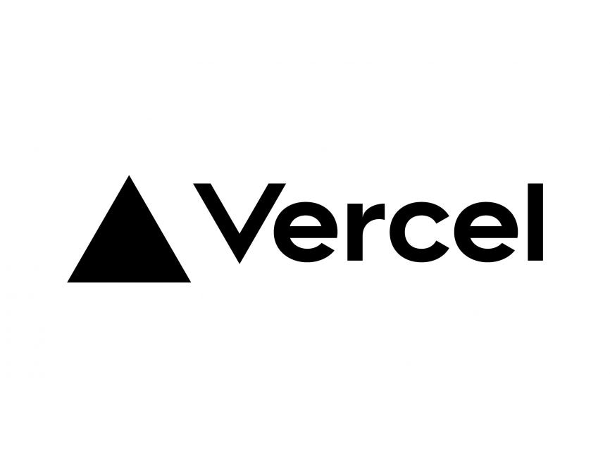
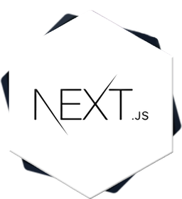
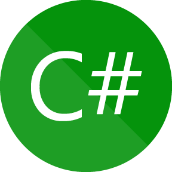
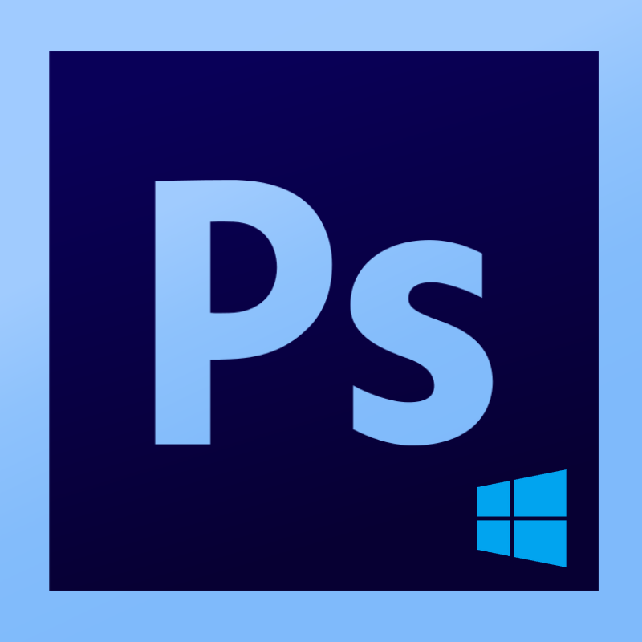
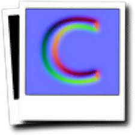
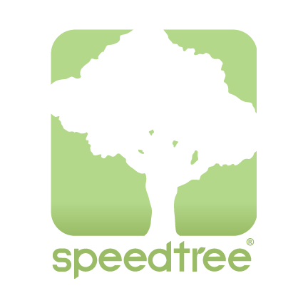
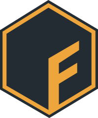
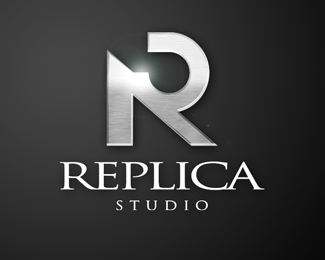

### Hello World, I'm Darlan Schwartz  👋

 
 
#### I'm a Problem Solver, also known as Software Engineer.
- First, my code and stats may look outdated because i'm working/using Gitlab in the past few years.
- 🌱 Currently learning **AWS** (Lambda, EC2, S3, CloudFormation)
- 🏆 **3x Hackathon Winner** + 1 Second Place +1 Third Place +1 Fifth Place (7 participations total as Fullstack Developer)
- 🔗 **2 Web3 Hackathons** - experienced with blockchain technologies
- ✈️ **WebSummit 2025 Lisbon** - Won all-expenses-paid trip + tickets
- 💼 Career Growth: **Mid-Level → Tech Lead** in less than 2 years
- 🎮 **10+ years** in multiplatform game development
- 🌐 **5+ years** in web and mobile development (as of 2025)
- 🧠 Ability to quickly understand and read code in virtually any language
- 💬 Ask me about anything!
- 🌍 **Trilingual**: 
  -  English
  -  Spanish
  -  Portuguese (Native)
<!--  French +/- -->
 
 
 
 
 
<h2 align="center">⚡ Stats ⚡</h2>
 

  

    <!--  -->
     
     
  

 
 
<h2 align="center">Languages and tools</h2>
<h3 align="center">  Web  </h3>

 <table>
    <tbody>
      <tr>
        <th>Languages</th>
        <th>Frameworks</th>
        <th>Database</th>
        <th>Tools</th>
        <th>Cloud</th>
        <th>Others</th>
      </tr>
      <tr>
        <td style="border:1px solid #30363d;" align="left" dir="row">
          
           Javascript
        </td>
        <td style="border:1px solid #30363d;" align="left" dir="row">
          
           React
        </td>
        <td style="border:1px solid #30363d;" align="left" dir="row">
          
           Postgresql
        </td>
        <td style="border:1px solid #30363d;" align="left" dir="row">
          
           Git
        </td>
        <td style="border:1px solid #30363d;" align="left" dir="row">
          
           GCP
        </td>
        <td style="border:1px solid #30363d;" align="left" dir="row">
          
           JIRA
        </td>
      </tr>
      <tr>
        <td style="border:1px solid #30363d;" align="left" dir="row">
          
           Typescript
        </td>
        <td style="border:1px solid #30363d;" align="left" dir="row">
          
           Node.js
        </td>
        <td style="border:1px solid #30363d;" align="left" dir="row">
          
           Prisma
        </td>
        <td style="border:1px solid #30363d;" align="left" dir="row">
          
           GitHub
        </td>
        <td style="border:1px solid #30363d;" align="left" dir="row">
          
           AWS
        </td>
        <td style="border:1px solid #30363d;" align="left" dir="row">
          
           Asana
        </td>
      </tr>
      <tr>
        <td style="border:1px solid #30363d;" align="left" dir="row">
          
           HTML
        </td>
        <td style="border:1px solid #30363d;" align="left" dir="row">
          
           Express
        </td>
        <td style="border:1px solid #30363d;" align="left" dir="row">
          
           Redis
        </td>
        <td style="border:1px solid #30363d;" align="left" dir="row">
          
           VS Code
        </td>
        <td style="border:1px solid #30363d;" align="left" dir="row">
          
           Vercel
        </td>
        <td style="border:1px solid #30363d;" align="left" dir="row">
          
           Notion
        </td>
      </tr>
      <tr>
        <td style="border:1px solid #30363d;" align="left" dir="row">
          
           CSS
        </td>
        <td style="border:1px solid #30363d;" align="left" dir="row">
                
           Next.js
        </td>
        <td style="border:1px solid #30363d;" align="left" dir="row">
          
           MongoDB
        </td>
        <td style="border:1px solid #30363d;" align="left" dir="row">
          
           Figma
        </td>
        <td style="border:1px solid #30363d;" align="left" dir="row">
          
           Docker
        </td>
        <td style="border:1px solid #30363d;" align="left" dir="row">
          
           Terminal
        </td>
      </tr>
      <tr>
       <td style="border:1px solid #30363d;" align="left" dir="row">
          
           Bash
        </td>
        <td style="border:1px solid #30363d;" align="left" dir="row">
          
           React-Native
        </td>
          <td style="border:1px solid #30363d;" align="left" dir="row">
          
           Mongoose
        </td>
        <td style="border:1px solid #30363d;" align="left" dir="row">
          
           GitLab
        </td>
        <td style="border:1px solid #30363d;" align="left" dir="row">
          
           Nginx
        </td>
      </tr>
      <tr>
        <td style="border:1px solid #30363d;" align="left" dir="row">
        
           Csharp
        </td>
        <td style="border:1px solid #30363d;" align="left" dir="row">
          
           Jest
        </td>
        <td style="border:1px solid #30363d;" align="left" dir="row">
        </td>
        <td style="border:1px solid #30363d;" align="left" dir="row">
        
           npm
        </td>
        <td style="border:1px solid #30363d;" align="left" dir="row">
        </td>
        <td style="border:1px solid #30363d;" align="left" dir="row">
          
           Babel
        </td>
      </tr>
    </tbody>
  </table>
  

<h3 align="center">Game Development</h3>

  <table>
    <tbody>
      <tr>
        <td style="border:1px solid #30363d;" align="left" dir="row">
          
           Csharp
        </td>
        <td style="border:1px solid #30363d;" align="left" dir="row">
          
           Visual Studio 
        </td>
        <td style="border:1px solid #30363d;" align="left" dir="row">
          
           .NET
        </td>
        <td style="border:1px solid #30363d;" align="left" dir="row">
          
           Audacity
        </td>
        <td style="border:1px solid #30363d;" align="left" dir="row">
          
           Unity
        </td>
        <td style="border:1px solid #30363d;" align="left" dir="row">
          
           Photoshop
        </td>
      </tr>
      <tr>
        <td style="border:1px solid #30363d;" align="left" dir="row">
          
           Blender
        </td>
        <td style="border:1px solid #30363d;" align="left" dir="row">
          
           Crazy Bump
        </td>
                <td style="border:1px solid #30363d;" align="left" dir="row">
         
           Speed Tree
        </td>
        <td style="border:1px solid #30363d;" align="left" dir="row">
          
           Shotcut
        </td>
        <td style="border:1px solid #30363d;" align="left" dir="row">
          
           Mixamo
        </td>
        <td style="border:1px solid #30363d;" align="left" dir="row">
          
           Fuse
        </td>
      </tr>
      <tr>
        <td style="border:1px solid #30363d;" align="left" dir="row">
          
           MakeHuman
        </td>
        <td style="border:1px solid #30363d;" align="left" dir="row">
          
           Android
        </td>
        <td style="border:1px solid #30363d;" align="left" dir="row">
          
           Android Studio
        </td>
 <td style="border:1px solid #30363d;" align="left" dir="row">
          
           Replica
        </td>
        <td style="border:1px solid #30363d;" align="left" dir="row">
         
           Photon
        </td>
          <td style="border:1px solid #30363d;" align="left" dir="row">
        </td>
      </tr>
    </tbody>
  </table>

# :speaker: Contact me

